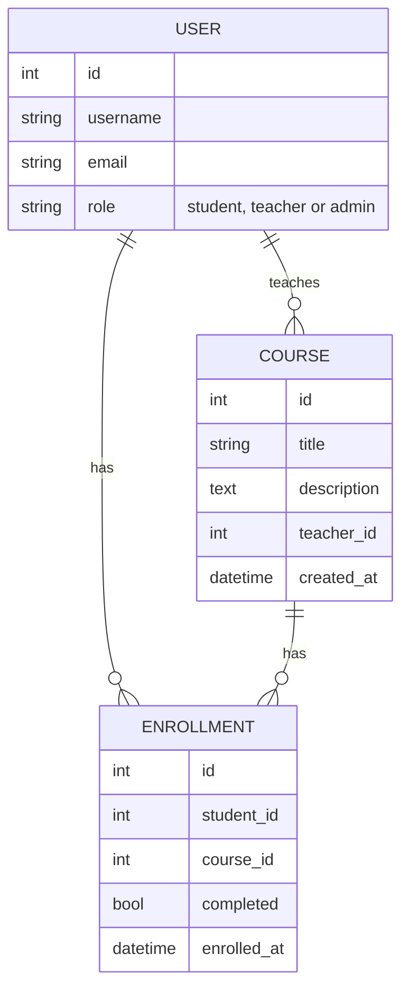

# Learning Management System

A full-stack web app where students browse and enrol in courses, teachers create and manage
their own courses, and admins manage everyone. Built with a **Django REST Framework** API
and a **React** frontend.

## Contents

- [Features](#features)
- [Demo accounts](#demo-accounts)
- [Tech stack](#tech-stack)
- [Design](#design)
- [Project structure](#project-structure)
- [Running it locally](#running-it-locally)
- [Environment variables](#environment-variables)
- [Testing](#testing)
- [API endpoints](#api-endpoints)
- [Deployment](#deployment)
- [Development process](#development-process)
- [Known limitations and future improvements](#known-limitations-and-future-improvements)

## Features

### Everyone

- Register as a student or teacher, log in and log out.
- Stay logged in after refreshing, using a saved token.
- A dashboard with a summary for each role.
- Works on phones, tablets and laptops.

### Students

- Browse and search every course by title, description or teacher.
- Enrol in and leave courses.
- **My courses** lists their courses with an overall progress bar.
- Mark courses complete or not complete.

### Teachers

- Create courses.
- Edit and delete **their own** courses only.
- See their courses and total students on the dashboard.

### Admins

- Edit and delete any course.
- See every user, filter by role, change roles and delete users.
- Can't change or delete their own account, so they can't lock themselves out.

### Security

- Every page and API endpoint checks the user's role. Hiding a link in the frontend is never
  the only protection: the API rejects anything the user isn't allowed to do.
- Nobody can register as an admin.
- Passwords are hashed and checked against Django's password rules.

## Demo accounts

The live site is filled with demo data by `python manage.py seed_demo` on every deploy.

| Role | Username | Password |
|---|---|---|
| Student | `student2` | `test123$` |
| Student | `student3` | `test123$` |
| Teacher | `teacher2` | `test123$` |
| Admin | Ask the project owner | |

These are demo accounts for testing only.

## Tech stack

| Part | Technology |
|---|---|
| Backend | Python, Django 4.2, Django REST Framework, token authentication |
| Database | SQLite |
| Frontend | React, React Router, Vite |
| Styling | Plain CSS with custom properties (no framework) |
| Backend tests | Django's test runner with DRF's `APITestCase` |
| Frontend tests | Vitest and React Testing Library |
| Linting | flake8 (backend), oxlint (frontend) |
| Hosting | Render (backend, with gunicorn and whitenoise), Netlify (frontend) |

## Design

Wireframes for every page, the user roles and a site map are in
[docs/wireframes.md](docs/wireframes.md).

### Data model



- A student can only enrol in each course once. The database enforces this with
  `unique_together`.
- Deleting a teacher deletes their courses, and deleting a course deletes its enrollments.

## Project structure

```text
Learning Mangement System/
├── backend/
│   ├── accounts/          # Custom User model, auth and user management API
│   ├── courses/           # Course and Enrollment models and API
│   │   └── management/commands/seed_demo.py
│   ├── lms_project/       # Settings and URLs
│   ├── build.sh           # Run by Render on every deploy
│   ├── requirements.txt
│   └── .env.example
├── frontend/
│   ├── src/
│   │   ├── api.js         # All calls to the backend
│   │   ├── AuthContext.jsx
│   │   ├── App.jsx        # Routes
│   │   ├── components/    # Layout, RequireAuth, CourseCard
│   │   ├── pages/         # One file per page
│   │   └── test/          # Frontend tests
│   └── .env.example
├── docs/wireframes.md
└── netlify.toml
```

## Running it locally

You need **Python 3.9 or newer** and **Node 20.19 or newer**.

### 1. Backend

```bash
cd backend
python3 -m venv venv
source venv/bin/activate          # Windows: venv\Scripts\activate
pip install -r requirements.txt
python manage.py migrate
python manage.py seed_demo        # optional: demo users and courses
python manage.py createsuperuser  # optional: your own admin account
python manage.py runserver
```

The API runs at http://127.0.0.1:8000/api/ and the Django admin at
http://127.0.0.1:8000/admin/.

### 2. Frontend

In a second terminal:

```bash
cd frontend
npm install
npm run dev
```

Open http://localhost:5173. The frontend talks to the backend at
`http://127.0.0.1:8000/api` unless `VITE_API_URL` says otherwise.

## Environment variables

Every variable has a safe default for local development, so you don't need a `.env` file to
run the project on your own computer.

### Backend (see `backend/.env.example`)

| Variable | Purpose | Local default |
|---|---|---|
| `SECRET_KEY` | Django's secret key. Must be long and random in production. | A development key |
| `DEBUG` | `True` locally, `False` in production | `True` |
| `ALLOWED_HOSTS` | Addresses the backend answers to | `localhost,127.0.0.1` |
| `CORS_ALLOWED_ORIGINS` | Frontend addresses allowed to call the API | `http://localhost:5173` |
| `CSRF_TRUSTED_ORIGINS` | Needed to log into `/admin` over HTTPS | Empty |
| `DJANGO_SUPERUSER_USERNAME`, `_EMAIL`, `_PASSWORD` | Used by `build.sh` to create the admin on deploy | Not set |

### Frontend (see `frontend/.env.example`)

| Variable | Purpose | Local default |
|---|---|---|
| `VITE_API_URL` | Where the API lives | `http://127.0.0.1:8000/api` |

## Testing

### Backend: 24 tests

```bash
cd backend
python manage.py test
```

They cover registering, logging in and out, admin-only user management, course permissions
for each role, enrolling, and marking courses complete.

### Frontend: 67 tests

```bash
cd frontend
npx vitest run
```

There's a test file for each page, plus `RequireAuth` and `Layout`. The tests use a pretend
backend (`mockApi` in `src/test/helpers.jsx`), so they run in seconds without Django.

### Linting

```bash
cd backend && flake8
cd frontend && npm run lint
```

### Manual testing

| Check | Expected |
|---|---|
| Visit `/dashboard` while logged out | Sent to the login page, then back to the dashboard after logging in |
| Log in as a student and visit `/users` | Sent to the home page |
| As a teacher, open another teacher's course | No **Edit** or **Delete** buttons |
| As a teacher, open another teacher's `/courses/:id/edit` link | "You can only edit your own courses." |
| Enrol, then refresh | Still enrolled, and the count has gone up |
| Refresh while on `/courses` on the live site | Stays on the course list |
| Tab through the login form with the keyboard | Every field and button shows a focus outline |
| Narrow the browser to phone width | Nav wraps, cards stack, the users table scrolls |

## API endpoints

All endpoints start with `/api/`. Apart from register and login, every request needs the
header `Authorization: Token <token>`.

| Method | Endpoint | Who | Purpose |
|---|---|---|---|
| POST | `/auth/register/` | Anyone | Create a student or teacher account and get a token |
| POST | `/auth/login/` | Anyone | Get a token |
| POST | `/auth/logout/` | Logged in | Delete the token |
| GET | `/auth/me/` | Logged in | The current user |
| GET | `/users/` | Admin | List users |
| GET, PATCH, DELETE | `/users/:id/` | Admin | View, change the role of, or delete a user |
| GET | `/courses/` | Logged in | List courses |
| POST | `/courses/` | Teacher, admin | Create a course |
| GET | `/courses/:id/` | Logged in | View a course |
| PATCH, DELETE | `/courses/:id/` | The course's teacher, admin | Edit or delete a course |
| POST | `/courses/:id/enroll/` | Student | Enrol |
| POST | `/courses/:id/unenroll/` | Student | Leave a course |
| GET | `/enrollments/` | Logged in | The current user's enrollments |
| PATCH | `/enrollments/:id/` | Owner | Mark complete or not complete |

## Deployment

### Backend on Render

- **Root directory:** `backend`
- **Build command:** `./build.sh`, which installs packages, collects static files, migrates,
  loads the demo data and creates the admin
- **Start command:** `gunicorn lms_project.wsgi:application`
- **Environment variables:** `PYTHON_VERSION=3.12.7`, `SECRET_KEY`, `DEBUG=False`,
  `CORS_ALLOWED_ORIGINS` (the Netlify address), `CSRF_TRUSTED_ORIGINS` (the Render address)
  and the three `DJANGO_SUPERUSER_*` variables
- Static files, including the Django admin's styles, are served by whitenoise.

### Frontend on Netlify

- Configured by `netlify.toml`: builds `frontend/` with `npm run build` and publishes `dist`.
- **Environment variable:** `VITE_API_URL=https://YOUR-SERVICE.onrender.com/api`, set before
  building, because Vite includes it in the built JavaScript.
- An SPA redirect sends every URL to `index.html`, so React Router can handle page refreshes
  and direct links.

## Development process

- The backend was built first, then the frontend, so every page had a working API to call.
- Each Django app followed the same order: models, migrations, admin, serializers,
  permissions, views, URLs, tests.
- Commits follow [Conventional Commits](https://www.conventionalcommits.org/), for example
  `feat(courses): add courses and enrollments API` or `test(frontend): add CoursesPage tests`.

### Bugs found and fixed

| Bug | Cause | Fix |
|---|---|---|
| The API ignored tokens and returned `403` | The `REST_FRAMEWORK` settings had been commented out | Re-enabled token authentication and the login requirement |
| Course API returned a server error | The serializer listed an `updated_at` field the model didn't have | Removed the field from the serializer |
| Test users failed with a unique email error | The User model requires a unique email, and test users had none | Gave every test user an email |
| Protected pages showed nothing | Pages were passed into `RequireAuth` as children, but it renders an `<Outlet />` | Nested the protected routes under `RequireAuth` routes |

## Known limitations and future improvements

- **The live database resets.** Render's free plan has no permanent disk, so the SQLite
  database is rebuilt with the demo data on each deploy. A hosted database like PostgreSQL
  would fix this.
- **No lessons inside courses.** Courses have a title and description. Lessons, materials and
  quizzes would be the next feature.
- **No pagination.** Every course and user is loaded at once, which won't scale to thousands.
- **No integration tests.** Each page is tested on its own, but not the whole app together. An
  end-to-end tool like Playwright would catch problems between pages.
- **No password reset or confirm-password field** on registration.

## Author

Built by [Niel Tailor](https://github.com/Niel-Tailor).