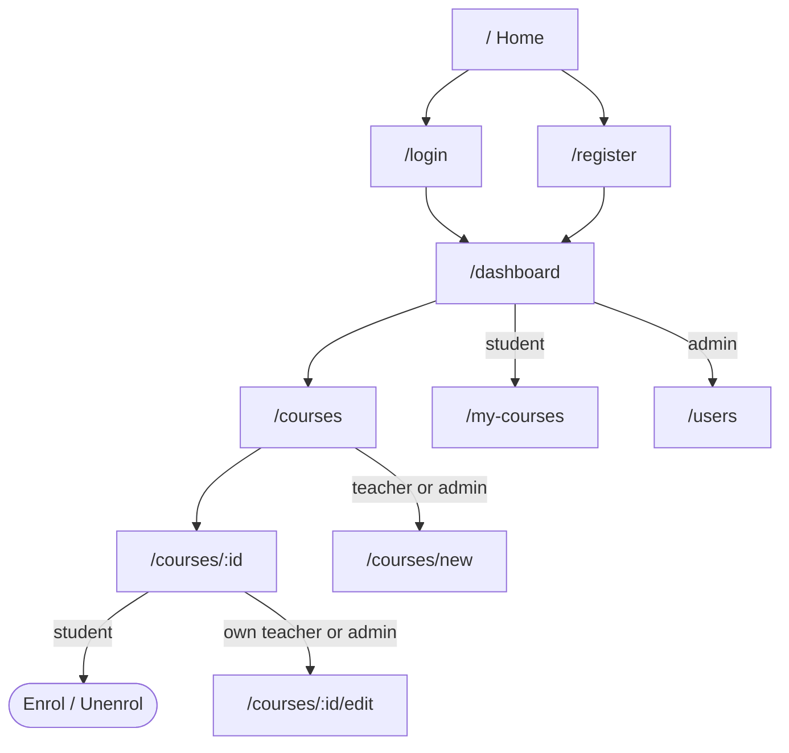

# Wireframes

Low-fidelity wireframes for the Learning Management System. They show the layout and
content of each page, not the final colours or styling.

## Contents

1. [Roles](#roles)
2. [Site map and user flow](#site-map-and-user-flow)
3. [Shared layout](#shared-layout)
4. [Public pages](#public-pages): Home, Log in, Register, Page not found
5. [Every logged-in user](#every-logged-in-user): Dashboard, Courses, Course detail
6. [Students](#students): My courses
7. [Teachers and admins](#teachers-and-admins): New / edit course
8. [Admins](#admins): Users
9. [Small screens](#small-screens)

## Roles

| Role | Can do |
|---|---|
| **Visitor** (logged out) | See the home page, register, log in |
| **Student** | Browse courses, enrol and unenrol, see their courses, mark courses complete |
| **Teacher** | Browse courses, create courses, edit and delete their own courses |
| **Admin** | Everything a teacher can do on any course, plus manage users and their roles |

Nobody can register as an admin. Admins are created with `createsuperuser` or promoted by
another admin on the Users page.

## Site map and user flow



Protected pages send logged-out visitors to `/login`, then back to the page they wanted
after logging in. Users with the wrong role are sent to the home page.

## Shared layout

Every page sits inside the same frame. The nav links change with the user's role.

```text
+----------------------------------------------------------------------+
| LMS     Dashboard  Courses  [role links]   student1 (student) [Log out]|
+----------------------------------------------------------------------+
|                                                                      |
|                         ( page content )                             |
|                                                                      |
+----------------------------------------------------------------------+
```

| Logged in as | Extra nav links |
|---|---|
| Visitor | `Log in`, `[Register]` (instead of the links above) |
| Student | `My courses` |
| Teacher | `New course` |
| Admin | `New course`, `Users` |

## Public pages

### Home `/`

```text
+----------------------------------------------------------------------+
| LMS                                              Log in   [Register] |
+----------------------------------------------------------------------+
|  Learning Management System                                          |
|  Browse courses, enrol in the ones you like, and track your progress.|
|  Teachers can create and manage their own courses.                   |
|                                                                      |
|  [Get started]  [Log in]                                             |
|                                                                      |
|  (logged in: "Welcome back, Sam." [Go to your dashboard] [Browse])   |
+----------------------------------------------------------------------+
```

### Log in `/login`

```text
+----------------------------------------------------------------------+
|  Log in                                                              |
|                                                                      |
|  Username  [______________________]                                  |
|  Password  [______________________]                                  |
|                                                                      |
|  ! Invalid username or password.        (only shown on an error)     |
|                                                                      |
|  [Log in]                                                            |
|  New here? Create an account                                         |
+----------------------------------------------------------------------+
```

### Register `/register`

```text
+----------------------------------------------------------------------+
|  Create an account                                                   |
|                                                                      |
|  Username  [______________________]                                  |
|  Email     [______________________]                                  |
|  Password  [______________________]   (at least 8 characters)        |
|  I am a    [ Student  v ]             (Student or Teacher only)      |
|                                                                      |
|  ! username: A user with that username already exists.               |
|                                                                      |
|  [Register]                                                          |
|  Already have an account? Log in                                     |
+----------------------------------------------------------------------+
```

### Page not found `*`

```text
+----------------------------------------------------------------------+
|  Page not found                                                      |
|  Sorry, there's nothing at this address.                             |
|  [Back to home]                                                      |
+----------------------------------------------------------------------+
```

## Every logged-in user

### Dashboard `/dashboard`

The dashboard shows each role a different summary.

```text
STUDENT
+----------------------------------------------------------------------+
|  Hello, Sam                                                          |
|  +--------------+  +--------------+  +--------------+                |
|  |      3       |  |      1       |  |     33%      |                |
|  | Courses      |  | Completed    |  | Progress     |                |
|  | enrolled     |  |              |  |              |                |
|  +--------------+  +--------------+  +--------------+                |
|                                                                      |
|  Still in progress                                                   |
|  - Web Development with Django                                       |
|  - Intro to Algorithms                                               |
|  [Go to my courses]                                                  |
+----------------------------------------------------------------------+

TEACHER
+----------------------------------------------------------------------+
|  Hello, Ada                                                          |
|  +--------------+  +--------------+                                  |
|  |      2       |  |      5       |                                  |
|  | Your courses |  | Students     |                                  |
|  +--------------+  +--------------+                                  |
|                                                                      |
|  Your courses                                        [New course]    |
|  +------------------+  +------------------+                          |
|  | (course card)    |  | (course card)    |                          |
|  +------------------+  +------------------+                          |
+----------------------------------------------------------------------+

ADMIN
+----------------------------------------------------------------------+
|  Hello, admin                                                        |
|  [Students 3] [Teachers 2] [Admins 1] [Courses 3] [Enrollments 4]    |
|                                                                      |
|  Most popular course                                                 |
|  Python Basics (2 enrolled)                                          |
|  [Manage users]  [Manage courses]                                    |
+----------------------------------------------------------------------+
```

### Courses `/courses`

```text
+----------------------------------------------------------------------+
|  Courses                                   [New course] (teacher/admin)|
|  [ Search by title, description or teacher ____________________ ]    |
|                                                                      |
|  +--------------------+ +--------------------+ +--------------------+|
|  | Python Basics      | | Web Development    | | Intro to           ||
|  | Taught by Ada      | | with Django        | | Algorithms         ||
|  | Lovelace           | | Taught by Ada      | | Taught by Alan     ||
|  | Variables, loops   | | Lovelace           | | Turing             ||
|  | and functions.     | | Models, views...   | | Sorting, ...       ||
|  |                    | |                    | |                    ||
|  | 2 students [Enrolled]| 1 student          | | 1 student          ||
|  +--------------------+ +--------------------+ +--------------------+|
|                                                                      |
|  (empty: "No courses yet."  /  "No courses match your search.")      |
+----------------------------------------------------------------------+
```

Each title links to the course's detail page.

### Course detail `/courses/:id`

```text
+----------------------------------------------------------------------+
|  <- All courses                                                      |
|                                                                      |
|  Python Basics                                                       |
|  Taught by Ada Lovelace  .  3 enrolled                               |
|  [You're enrolled]                       (students who are enrolled) |
|                                                                      |
|  Variables, loops and functions.                                     |
|                                                                      |
|  You're now enrolled!                    (after an action)           |
|                                                                      |
|  Student:                    [Enrol]  or  [Unenrol]                  |
|  Course's teacher or admin:  [Edit]  [Delete]                        |
|  Other teachers:             (no buttons)                            |
+----------------------------------------------------------------------+
```

Deleting asks "Delete "Python Basics"? This can't be undone." before going ahead.

## Students

### My courses `/my-courses`

```text
+----------------------------------------------------------------------+
|  My courses                                                          |
|  +----------------------------------------------------------------+  |
|  | 1 of 2 courses completed (50%)                                 |  |
|  | [##############################..............................] |  |
|  +----------------------------------------------------------------+  |
|                                                                      |
|  +----------------------------------------------------------------+  |
|  | Python Basics                                  [Mark complete] |  |
|  | Taught by Ada Lovelace . enrolled 01/11/2026                   |  |
|  +----------------------------------------------------------------+  |
|  | Web Development with Django   [Completed] [Mark not complete]  |  |
|  | Taught by Ada Lovelace . enrolled 02/11/2026                   |  |
|  +----------------------------------------------------------------+  |
|                                                                      |
|  (empty: "You're not enrolled in any courses yet. Browse courses")   |
+----------------------------------------------------------------------+
```

## Teachers and admins

### New course `/courses/new` and edit course `/courses/:id/edit`

One form does both. In edit mode it is filled in with the course's current details.

```text
+----------------------------------------------------------------------+
|  New course                         (or "Edit course")               |
|                                                                      |
|  Title        [______________________________________]               |
|  Description  [______________________________________]               |
|               [______________________________________]               |
|               [______________________________________]               |
|                                                                      |
|  ! title: This field is required.        (only shown on an error)    |
|                                                                      |
|  [Create course] (or [Save changes])  [Cancel]                       |
+----------------------------------------------------------------------+
```

A teacher opening another teacher's edit link sees "You can only edit your own courses."
instead of the form.

## Admins

### Users `/users`

```text
+----------------------------------------------------------------------+
|  Users                                        Show [ All roles  v ]  |
|  +----------------------------------------------------------------+  |
|  | Username      | Name          | Email              | Role      |  |
|  |---------------+---------------+--------------------+-----------|  |
|  | admin (you)   | -             | admin@example.com  | [admin v] |  |
|  |               |               |                    | (locked)  |  |
|  | teacher1      | Ada Lovelace  | teacher1@...       | [teacher v] [Delete] |
|  | student1      | Sam Patel     | student1@...       | [student v] [Delete] |
|  +----------------------------------------------------------------+  |
+----------------------------------------------------------------------+
```

- Changing a role in a row saves straight away.
- Admins can't change or delete their own account.
- Deleting a teacher warns that their courses will be deleted too.

## Small screens

On screens narrower than 600px:

- The nav links wrap onto a second line under **LMS**.
- Course cards and dashboard stats stack into a single column.
- The users table scrolls sideways instead of squashing.

```text
+------------------------+
| LMS                    |
| Dashboard Courses      |
| My courses [Log out]   |
+------------------------+
| Courses                |
| [Search ___________]   |
| +--------------------+ |
| | Python Basics      | |
| | Taught by Ada ...  | |
| +--------------------+ |
| +--------------------+ |
| | Intro to Algorithms| |
| +--------------------+ |
+------------------------+
```